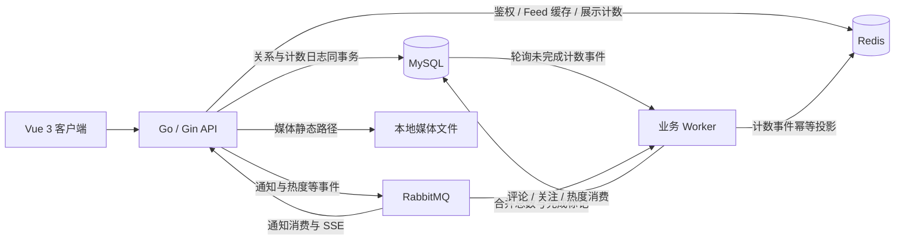

# VidFlow

**面向热点互动计数与稳定分页的短视频 Feed 后端。**

基于 Go + Vue 3 的短视频工程项目，提供发布、浏览、点赞、评论、关注、私信与通知的业务闭环。围绕关注流刷新、分页边界和点赞计数做专项改造，保留源码、回归测试与可复现的前后对照实验。

`Go` · `Gin` · `GORM` · `MySQL` · `Redis / Lua` · `RabbitMQ` · `Vue 3` · `Docker Compose`

[快速运行](#快速运行) · [架构与一致性设计](handbook/architecture.md) · [压测证据](experiments/like-count/results/20261115T083209Z-ab/REPORT.md) · [项目讲解与简历参考](handbook/interview.md) · [接口文档](handbook/api.md)

## 三个工程问题

| 问题 | 实现与取舍 | 验证入口 |
|---|---|---|
| 同时间作品跨页遗漏；刷新后旧响应覆盖新列表 | 时间＋ID 复合游标；版本化缓存校验读写；前端请求取消与序号隔离 | [发布、刷新、10/10/6 连续分页验收](experiments/feed-following/03-combined-flow-results.md) |
| 热门视频每次点赞都更新同一数据库行 | 关系与恢复日志同事务；Redis 优先计数；按视频聚合增量，计数和完成标记同事务提交 | [计数实现](backend/internal/video/like_count.go) · [故障与幂等测试](backend/internal/video/like_count_test.go) |
| 优化收益缺少可核对的数据 | 隔离 A/B、固定请求率、热点/分散分布、交替执行两版；同时统计延迟、视频行更新和全库写入 | [24 轮压测与原始记录](experiments/like-count/README.md) |

## 一组有条件的优化结果

2026-11-15，在相同资源配额下，按 50 / 150 / 300 req/s 测试热点与 64 视频分散场景，每轮 6 秒、两轮交替 A→B / B→A，共 **24,000 次主测请求**。接口请求全部成功，最终逐视频关系数与数据库计数一致，并发重复点赞只累计一次。

以下是 **300 req/s、单视频热点场景**；行写入数为两轮合计，延迟为合并样本，追平时间为两轮范围。

| 指标 | 旧版 | 当前实现 |
|---|---:|---:|
| 视频行更新，含点赞数和热度 | 7,200 | **7** |
| 全库行写入操作 | 14,400 | 14,415 |
| HTTP P95 / P99 | 2.94 / 3.64 ms | 7.91 / 9.44 ms |
| 停写后的数据库计数追平 | 8.32–9.95 s | **4.22–4.73 s** |

收益是视频热点行更新减少 **99.90%**，以及该负载下积压追平更快。关系恢复日志增加了写入成本，全库行写入基本持平；新版接口要同步确认关系与日志提交，响应承诺和旧版不同。低负载下批处理等待也会拉长计数追平时间。当前实验没有测得系统吞吐上限或多 Worker 扩展收益。

[完整方法与边界](experiments/like-count/README.md) · [各场景结果](experiments/like-count/results/20261115T083209Z-ab/REPORT.md) · [每轮指标及每表 I/O](experiments/like-count/results/20261115T083209Z-ab/summary.json)

## 系统架构



采用模块化单体与独立业务 Worker。**计数批处理直接读取数据库增量日志**；RabbitMQ 承载通知、评论、关注、热度等事件。通知和时间线的部分消费者目前仍在 API 进程中。[详细时序、恢复机制与扩容边界 →](handbook/architecture.md)

## 功能与当前范围

| 模块 | 当前能力 |
|---|---|
| 视频 | 普通/分片上传、单片 MD5、断点续传会话、封面、发布、作者作品与话题标签 |
| Feed | 最新流、关注流、点赞榜、窗口热榜、话题流；热索引/历史查询分层与实体缓存 |
| 互动 | 点赞/取消、评论、关注/取关、用户主页统计、私信及通知记录/SSE |
| 工程 | JWT 与双 Token、账号限流、Docker Compose、API/Worker、pprof、CI 与自动化测试 |

推荐标签页当前使用最新流。媒体存储为本地文件；对象存储、转码、多码率、ES 和用户画像尚未实现。关系分片及复合主键布局是独立实验方案，业务关系表尚未迁移。分片上传仍需补整文件校验、并发进度更新和合并幂等，这些缺口及验收标准列在[后续工作](handbook/architecture.md#4-当前能力与下一步)。

## 快速运行

```bash
git clone https://github.com/luob8110-afk/VidFlow.git
cd VidFlow
docker compose up -d --build
```

| 入口 | 地址 |
|---|---|
| 页面 | http://localhost:5173 |
| API | http://localhost:8080 |
| RabbitMQ 管理台 | http://localhost:15672 |

注册两个账号，发布作品并建立关注关系；在关注页主动刷新查看新作品，连续翻页；对同一个点赞按钮再次点击取消。接口重试、刷新失败和迟到响应使用自动化测试复现。

本地默认凭据及环境变量见[运行文档](handbook/development.md)。从旧版升级需先排空旧点赞消息并一起更新 API 与 Worker；真实 MySQL 集成测试须配置独立测试库，未配置时会跳过。[运行、升级与测试 →](handbook/development.md)

## 阅读代码

| 设计入口 | 关键文件 |
|---|---|
| 点赞关系与恢复日志事务 | [like_service.go](backend/internal/video/like_service.go) |
| 计数冷启动、回源与批量事务 | [like_count.go](backend/internal/video/like_count.go) |
| Redis 原子去重与计数 | [redis/like_count.go](backend/internal/middleware/redis/like_count.go) |
| 关注流版本缓存与分页 | [feed/service.go](backend/internal/feed/service.go) · [following_cursor.go](backend/internal/feed/following_cursor.go) |
| 前端请求生命周期 | [useVideoFeed.ts](frontend/src/composables/useVideoFeed.ts) |
| 发布与刷新组合回归 | [following_flow_test.go](backend/internal/feed/following_flow_test.go) · [useVideoFeed.test.mjs](frontend/tests/useVideoFeed.test.mjs) |

## 实验证据

- [关注流正确性与阶段验收](experiments/feed-following/03-combined-flow-results.md)：固定集合分页、主动刷新、失败重试和迟到请求；附历史容量实验归档。
- [点赞计数 A/B](experiments/like-count/README.md)：固定基线 commit、隔离依赖、原始延迟样本、每表行写入、追平状态与源码哈希。
- [百万条关系的存储布局比较](experiments/edge-storage/README.md)：在同等最近点赞索引能力下，复合主键候选样本空间下降约 29%。该实验的 DAU 与存量规模属于演算假设。

## 来源与改造范围

项目基于 [LeoninCS/feedsystem_video_go](https://github.com/LeoninCS/feedsystem_video_go) 二次开发，基础账号、上传和社交功能继承自上游。VidFlow 的专项改造集中在关注流刷新/分页、点赞计数恢复与批处理，以及对照测试和实验记录。[具体贡献与讲解材料](handbook/interview.md)列出代码入口和表述口径。上游作者的后续项目见 [GCFeed](https://github.com/LeoninCS/GCFeed)。
