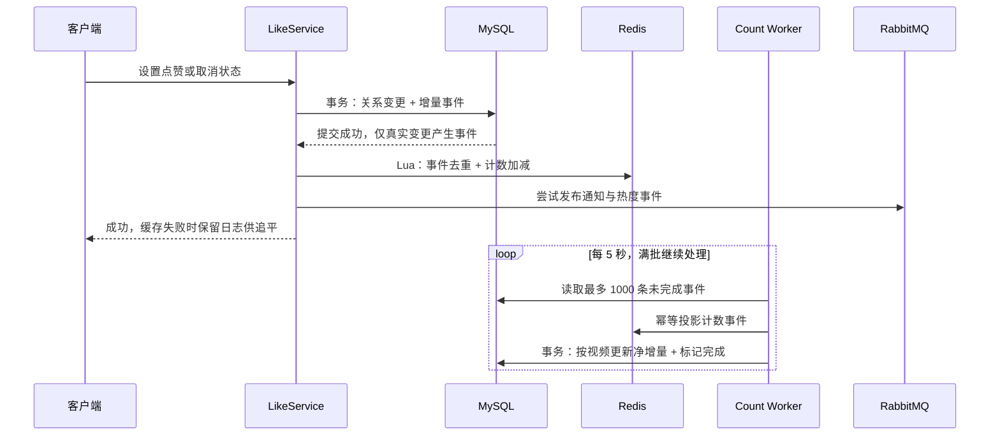

# 架构与一致性设计

[项目首页](../README.md) · [代码讲解与简历参考](interview.md) · [运行与验证](development.md)

VidFlow 使用模块化单体 API 和独立业务 Worker，存储依赖 MySQL、Redis 与 RabbitMQ。当前优化集中在关注流读取正确性和点赞计数写入路径。计数通过 MySQL 增量日志驱动批处理；通知和热度事件通过 RabbitMQ 分发，两条异步路径各有自己的失败边界。

## 1. 点赞：关系、计数、通知分别承诺什么

| 数据 | 事实来源与写入方式 | 接口成功时的含义 |
|---|---|---|
| 用户点赞关系 | MySQL 唯一关系，同步事务提交 | 目标关系变更及恢复日志已提交 |
| 视频展示计数 | Redis 优先，缺失时读取数据库基线加未完成增量 | 提交后尽力即时更新，失败由 Worker 重试 |
| 数据库视频计数 | Worker 按视频合并增量 | 允许批处理延迟，写入与日志完成标记同事务 |
| 作者通知 | RabbitMQ → 通知消费者 → 通知表/SSE | 当前不承诺与关系提交原子投递 |



### 重复请求与并发

数据库唯一索引约束 `(video_id, account_id)`；取消根据实际删除行数判断是否发生状态变化。已点赞时重复点赞、未点赞时重复取消均不产生新计数事件。用户再次点击与网络重试通过明确的目标状态区分。

Redis 将总数和事件 ID 放在同一 Hash，通过 Lua 合并执行去重与加减。整个 Hash 使用固定 1 小时生命周期，总数与标记一起过期。该机制处理计数事件重复应用；它不替代数据库的关系唯一约束。

### 冷启动与回源

直接从旧数据库总数初始化 Redis，可能漏掉尚未批量落库的增量。当前做法在 MySQL Repeatable Read 快照中同时读取数据库基线和计数日志：总数加上未完成增量，去重字段记录快照已包含的事件。这样，初始化后再处理同一事件不会加两遍。冷读完成后回填计数缓存，缓存关注页仍能读取实时展示总数。

### 批处理失败与重启

Worker 先应用 Redis 事件，再在一个数据库事务中提交视频净增量和日志完成标记。数据库事务失败时事件仍待处理，下一次可以重复执行 Redis 投影；数据库事务提交后不会再次选中已完成事件。多个刷新进程通过独立锁行串行领取批次，请求不获取这个刷新锁。

已完成日志保留 24 小时，待处理日志保留到成功处理。恢复依赖当前数据库基线、保留日志与有界的缓存更新调用。当前尚未实现长期灾备重放协议、无限期事件去重或自动修复升级前已有的计数偏差。

### 当前代价

每次有效关系变更仍要写入关系和独立日志；本方案减少视频热点行更新，日志也会产生写入与存储成本。全局刷新锁、逐事件缓存投影、按视频扫描保留日志进行初始化，都是后续容量测试需要关注的成本。当前未实现视频计数分桶、关系分库分表和通知事务 Outbox。

实现入口：[LikeService](../backend/internal/video/like_service.go)、[计数存储与批处理](../backend/internal/video/like_count.go)、[Redis Lua](../backend/internal/middleware/redis/like_count.go)、[Worker](../backend/internal/worker/likecountworker.go)。

## 2. 关注流：分页与刷新是两个问题

固定视频集合按 `create_time DESC, id DESC` 排序，游标携带时间精度与 ID。下一页查询：

```sql
WHERE create_time < :time
   OR (create_time = :time AND id < :id)
ORDER BY create_time DESC, id DESC
LIMIT :page_size_plus_one;
```

多取一条判断 `has_more`，避免恰好整页时错误宣告还有下一页。同时间作品可通过 ID 继续翻页。该完整性验证针对固定集合；翻页期间新发布的作品通过首屏刷新获取，不将连续分页描述为全站快照读取。最新流仍使用自己的时间游标，没有自动获得关注流的复合游标保证。

关注页缓存 TTL 为 30 秒，缓存键包含用户、版本、分页边界与页大小。主动刷新轮换版本并独立查库；缓存读取与写回都使用 Lua 校验版本。旧查询即使晚完成，也无法回填新版本缓存。关注与取关会轮换该用户的缓存版本。

前端使用 AbortController 和请求序号隔离迟到结果；取消未生效时，序号检查仍阻止旧响应覆盖新列表。刷新失败保留已有内容和游标，登录账号变化时清理旧关注状态。

一次组合验收用 25 条同时间旧作品加 1 条新发布作品，核对刷新后首条及 10/10/6 条分页的完整 ID 序列；受控测试覆盖旧查询暂停、刷新失败、重试和旧查询恢复。证据见[组合验收记录](../experiments/feed-following/03-combined-flow-results.md)。

实现入口：[复合游标](../backend/internal/feed/following_cursor.go)、[查询条件](../backend/internal/feed/repo.go)、[缓存版本原语](../backend/internal/middleware/redis/versioned_cache.go)、[关注服务](../backend/internal/feed/service.go)、[前端请求管理](../frontend/src/composables/useVideoFeed.ts)。

## 3. 发布、读取与媒体文件

视频元数据、话题关系和发布 Outbox 在同一数据库事务提交；后台投递时间线事件，消费者写入全局 Redis ZSET。最新流保留约 1,000 条热索引，历史页从数据库读取；实体读取使用本地缓存、Redis 与 MySQL，用户点赞状态按页批查。

这条发布链路已有本地事件表，但发送路径尚未启用 Publisher Confirm；不能把“调用发送成功后删除 Outbox”解释为完整的可靠消息闭环。最新时间线非空时也缺少持续检测落后程度的机制。

新作品通过 S3 分片直传，API 在完成时确认对象大小，Worker 校验整文件 SHA-256 并生成标准 MP4 和 JPEG 封面。发布事务检查资产归属与可发布状态。历史作品继续使用已有的静态播放路径。[视频生产、任务租约和故障验证](media-pipeline.md)

## 4. 当前能力与下一步

| 优先级 | 下一步 | 验收标准 |
|---|---|---|
| P1 | 长时间计数实验与对账 | 跨越缓存代际与日志清理窗口，核对关系、缓存、持久化计数及内存走势 |
| P1 | 消息确认、失败保留与通知恢复 | 断开连接或消费失败后，真实变更可追踪并重新处理 |
| P2 | 媒体任务在持续上传负载下的资源评估 | 对比直传与旧上传的 API 流量，采集处理等待、转码耗时和资源占用 |

关系索引布局已有百万条样本实验；一亿 DAU、存量规模、副本数与磁盘价格只是容量演算输入。ES、画像与推荐排序尚待建设。多实例还需要处理 SSE 跨进程投递和后台任务协作。
