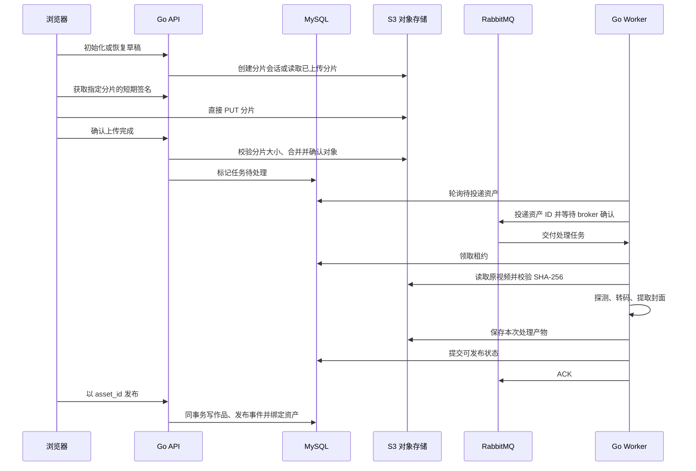

# 视频生产与发布

[项目首页](../README.md) · [接口文档](api.md)

客户端把分片直接发给 S3 兼容对象存储。Go API 负责会话、权限和发布状态，FFmpeg 在独立 Worker 中运行。



## 本地运行

启动 `docker compose up -d --build` 后访问 `http://localhost:5173/video`。Compose 提供 SeaweedFS 的 S3 网关，`worker` 镜像安装 FFmpeg 和 ffprobe。浏览器通过公开端点直传和播放，API 与 Worker 用内部端点访问对象存储。SeaweedFS 配置使用它的单节点开发模式。[SeaweedFS 本地 S3 指南](https://github.com/seaweedfs/seaweedfs#quick-start)

选一个不超过 200 MiB、最长 5 分钟的视频，点「上传视频」。处理完成后填写标题并点「发布」。在上传中断后，重新选择同一文件并点上传，浏览器从本地保存的草稿 ID 恢复，服务端读取对象存储确认的分片。浏览器以 HTTPS 或 localhost 使用 Web Crypto 计算整文件 SHA-256，当前实现计算哈希时会将文件读入内存。

| 设置 | 本地 Compose |
|---|---|
| `MEDIA_S3_ENDPOINT` | 容器内 `http://objectstore:8333`，本机运行 Go 时使用 `http://localhost:8333` |
| `MEDIA_S3_PUBLIC_ENDPOINT` | 默认 `http://localhost:8333`，应填写浏览器可达的 S3 源站地址 |
| `MEDIA_S3_BUCKET` | 默认 `vidflow-media` |
| `MEDIA_S3_ACCESS_KEY` / `MEDIA_S3_SECRET_KEY` | 见 `.env.example`，与对象存储凭据一致 |

使用已有 S3 兼容服务时，配置允许前端来源的上传 CORS。浏览器只收到签名 URL。URL 绑定对象、分片编号、上传会话和 Content-Length，有效期最长 15 分钟。开启对象存储后，发布接口要求 `asset_id`。历史本地视频仍从原路径播放。未配置 `MEDIA_S3_ENDPOINT` 时，原本地上传模式仍可使用。

## 状态与恢复

- **上传中 → 待处理。** MySQL 草稿按用户与客户端草稿 ID 唯一。同一草稿重复初始化使用同一资产。合并前检查连续分片及各片大小，合并后检查对象大小。如果合并成功但数据库提交失败，重试会识别已存在的对象并继续排队。Worker 下载时再验证整文件 SHA-256。[S3 分片完成语义](https://docs.aws.amazon.com/AmazonS3/latest/API/API_CompleteMultipartUpload.html)
- **待处理 → 处理中 → 可发布或失败。** MySQL 的资产行保存待投递状态。RabbitMQ 确认后更新下次投递时间，尚未领取的资产仍可重投。每个 Worker 只处理一个媒体任务，FFmpeg 使用受限线程和三分钟处理超时。任务租约为 3 分 20 秒，最多领取三次；失效租约可以由新的处理轮次接手。调度与租约均用 Unix 毫秒存储，便于 API 与 Worker 跨时区运行。[RabbitMQ 投递与消费确认](https://www.rabbitmq.com/docs/confirms)
- **产物与状态提交。** 每次领取使用独立的输出路径。只有持有当前有效租约的 Worker 能提交获胜产物。Worker 即使在上传产物后退出，下一轮也可重新生成。成功后尝试清理旧轮次产物。
- **可发布 → 已发布。** 发布事务锁定资产并校验归属和状态，写入作品、话题和原有时间线 Outbox，再记录作品 ID。相同资产的发布重试返回原作品。播放入口只为已发布资产签发对应产物的 GET，浏览器向对象存储读取字节范围。
- **过期与放弃。** 上传会话 24 小时有效，处理终止后的未发布资产保留 7 天。用户可放弃上传中、失败或待发布的资产。后台清理过期会话与关联对象，失败后重试。已发布资产保留原视频、播放文件与封面。

目前输出为单份 H.264 MP4，存在音轨时转为 AAC，并生成 JPEG 封面。发布 Outbox 使用投递确认，将事件分发给时间线和搜索的独立队列。[搜索索引与恢复](video-search.md)

## 验证

```bash
python experiments/media-pipeline/smoke.py
```

脚本通过前端反代调用真实 API，生成两片 MP4，验证续传、分片签名长度约束、越权拒绝、完整性失败、重复完成/发布、Feed 可见、JPEG 和视频 Range。脚本会在目标栈创建测试用户和作品，适用于独立测试实例。

可选的 `--reconcile-storage` 使用 PyMySQL 和支持 AWS SigV4 的 curl 模拟对象已合并、SQL 还未提交的场景，并验证放弃草稿后的回收。 `--crash-recovery` 在两份产物上传后、状态提交前终止 Worker，再启动并等待租约到期。脚本只锁定本次测试创建的资产。用 `--base`、`--worker` 和 `--mysql-port` 指向独立 Compose 实例。

2026-11-18 在隔离 Compose 环境中通过两片续传、越权拒绝、重复完成和发布、整文件校验失败、Feed 可见及 Range 播放检查。API 用 UTC+8，Worker 用 UTC，Chrome 从发布页直传并播放了生成的 360×640、3 秒视频。补测通过了对象已合并但 SQL 未提交时的恢复，以及放弃草稿后的回收。最终版本的 Worker 故障场景在重启后 200.5 秒恢复到可发布，随后通过发布与播放检查。耗时包含旧租约失效的等待，此实验使用单个测试视频。
