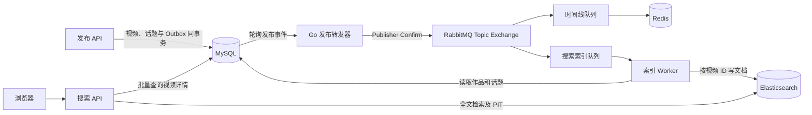

# 全站视频搜索

[项目首页](../README.md) · [接口文档](api.md#全站视频搜索-searchvideos)

访客可以在顶部输入中文标题、简介或发布时的作者名，按话题、作者 ID、发布日期缩小范围，从结果卡片进入播放页。排序优先考虑相关度，标题权重更高。同分按发布时间及视频 ID 排序。



- **增量同步。** 转发器预先声明两个持久队列。RabbitMQ 确认消息后才清理 Outbox。搜索 Worker 以视频 ID 写入 Elasticsearch，索引接受写入后再 ACK。搜索暂时不可用时，Worker 关闭当前消费会话，使未确认消息返回队列，三秒后重试。Elasticsearch 刷新后新视频才能被搜到。[RabbitMQ 确认语义](https://www.rabbitmq.com/docs/confirms)
- **历史回填。** 索引首次创建后记录 MySQL 最大视频 ID，按主键每批扫描 200 条。在 Elasticsearch 中用 Bulk Create，保留实时同步已写入的同 ID 文档。每批成功才更新索引内的检查点，Worker 重启后继续。索引维护时先停止 Worker，重建索引后再启动回填。
- **中文检索与分页。** 使用 Elasticsearch 自带 CJK 双字分词。话题按完整名称匹配，拉丁字母的大小写归一。PIT 和 `search_after` 固定分页结果，游标绑定查询条件，快照空闲两分钟到期。查询命中后从 MySQL 批量取详情，根据 Elasticsearch 排名返回，跳过已经从 MySQL 移除的记录。[CJK 分词](https://www.elastic.co/docs/reference/text-analysis/analysis-cjk-bigram-tokenfilter) · [快照分页](https://www.elastic.co/docs/reference/elasticsearch/rest-apis/paginate-search-results)

本地 Compose 启动 Elasticsearch 单节点，使用持久卷和 512 MiB JVM 堆，9200 仅在 Docker 网络内可见。API 与 Worker 使用相同的 `SEARCH_ES_URL`，默认 `http://elasticsearch:9200`，本机单独启动 Go 时需要显式填写。外部集群可通过 `SEARCH_ES_API_KEY` 配置凭证。各 API 实例共享 `JWT_SECRET` 以验证同一个分页游标。API 与 Worker 使用相同的数据库时间解释配置，本地 Compose 均使用 UTC。

本次范围覆盖发布和历史视频。作者名使用发布时快照，作者 ID 可精确筛选。公开下架和编辑事件接入搜索索引属于后续工作。

## 复现验证

在独立 Compose 项目中执行，脚本会写入测试用户与视频，并短暂停止 Elasticsearch 和 RabbitMQ。运行前保持 Worker 已创建但尚未启动。

```bash
docker compose -p vidflow-search-test up -d --build --wait elasticsearch frontend
docker compose -p vidflow-search-test build worker
docker compose -p vidflow-search-test create worker
python experiments/video-search/smoke.py --project vidflow-search-test
```

主机端口已占用时可通过 Compose override 调整，包括浏览器可访问的对象存储端口。脚本用 `--file` 传入每份 Compose 文件，用 `--base` 指定前端地址。

2026-11-18 在隔离 Compose 单节点环境中验证。

| 场景 | 观察结果 |
|---|---|
| 历史作品 | 220 条跨两批回填，两条同时间的匹配作品按 ID 稳定分页 |
| 新发布作品 | 发布到首次检索命中约 0.86 秒，访客在 Chrome 从搜索结果进入播放页，播放 360×640、3 秒的视频 |
| 检索查询 | 通过前端反代顺序请求 100 次，同一关键词和话题过滤条件下 HTTP P95 为 31.19 毫秒 |
| Elasticsearch 停机 | 发布成功，Redis 时间线继续更新，搜索返回 503。重启后 18.01 秒恢复命中，两次消息处理后只有一条搜索结果 |
| RabbitMQ 停机 | 发布成功，事件保留在 MySQL Outbox。重启后 7.47 秒恢复命中，Outbox 随确认清理 |

恢复时间从对应容器执行完 `start` 后开始计时，包含服务启动等待。搜索延迟来自本地串行请求。
